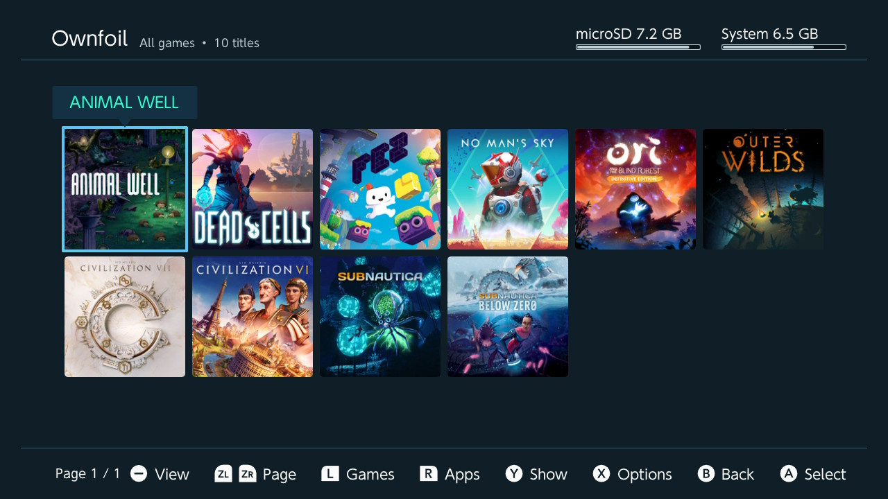
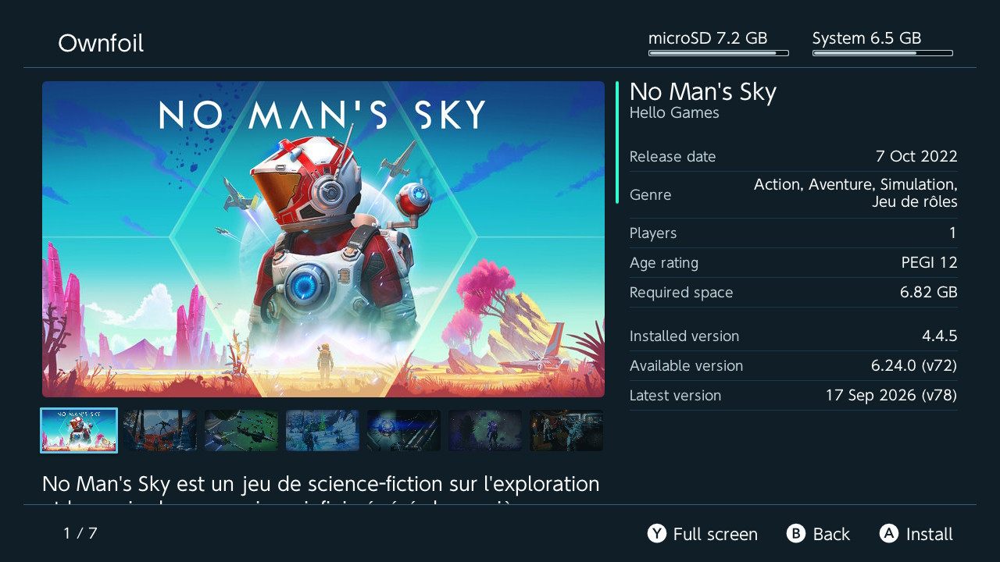

# NS eShop Client

An experimental Nintendo Switch homebrew client for self-hosted NS eShop servers.

This community project is derived from the Sphaira codebase and is intended for testing and development. It is not an official Nintendo product and does not connect to Nintendo's servers.

Please use the [issues tab](https://github.com/iPlaza3D/ns-eshop-client/issues) to report bugs and suggest improvements.

## Showcase

|                          |                          |
:-------------------------:|:-------------------------:
 | 

## Bug reports

For any bug reports, please use the issues tab and explain in as much detail as possible!

Please include:

- CFW type (i assume Atmosphere, but someone out there is still using Rajnx);
- CFW version;
- FW version;
- The bug itself and how to reproduce it.

### NS eShop server (install)

[iplaza3d/ns-eshop-server](https://github.com/iplaza3d/ns-eshop-server) provides the self-hosted Nintendo Switch library manager used by this experimental client. It exposes the GraphQL catalog, artwork and downloadable content needed by the console client.

Local servers are found automatically on the network, so there is no IP or port to type in. You can also add a server manually and configure both a local and a remote address over HTTP or HTTPS.

The library is browsed by *content*, not by files: pick a game, a version and the dlc you want, and the client works out which files it needs, however they are bundled (several nsp, or a multi content nsp / xci).  
Only what you picked is downloaded and installed. NSP, NSZ, XCI and XCZ are supported, and a download survives a broken connection, resuming for up to 60 seconds.

Entries are listed under `New games`, `Updates`, `DLC`, `All games` and `Search`, paginated and sortable. All artwork is served by the configured server, so the Switch never connects to Nintendo's servers.

The Switch client only exposes the NS eShop server workflow: select a saved or discovered server, browse its catalog, inspect a title and install the selected content.

## Building from source

You will first need to install [devkitPro](https://devkitpro.org/wiki/Getting_Started).

Next you will need to install the dependencies:
```sh
sudo pacman -S switch-dev deko3d switch-cmake switch-curl switch-glm switch-zlib switch-mbedtls
```

Also you need to have on your environment the packages `git`, `make`, `zip` and `cmake`

Once devkitPro and all dependencies are installed, you can now build NS eShop Client.

```sh
git clone https://github.com/iPlaza3D/ns-eshop-client.git
cd ns-eshop-client
cmake --preset Release
cmake --build --preset Release
```

The output will be found in `build/Release/ns-eshop-client.nro`, and the release package installs it under `/switch/ns-eshop-client/`.

The client keeps its own data on the SD card and does not require the original Sphaira application:

- Application: `/switch/ns-eshop-client/ns-eshop-client.nro`
- Server list and settings: `/config/ns-eshop-client/`
- Artwork and download cache: `/switch/ns-eshop-client/cache/`

If you used an earlier build, its old `/config/sphaira/` server list is not imported automatically; add the server again from the client.

### Using Docker

If you would rather not install and manage devkitPro on your machine, the nro can be built in a docker container instead, with the following tool:

```sh
tools/nro-builder/build.sh [Release|Dev|Lite] [--send]
```

The first run builds the image, which holds the same devkitA64 toolchain the release workflow uses, plus ninja and ccache.
The first build takes longer but after that only what you changed is compiled.

`Release` is the default and is what the release workflow publishes. `Dev` skips LTO, so a one file change is immediate.

The output will be found in `build/<preset>/ns-eshop-client.nro`. Add `--send` to send it straight to the console over `nxlink` and follow its log.

## Credits

This project uses the Sphaira codebase as its starting point. Please refer to the original [Sphaira project](https://github.com/ITotalJustice/sphaira) for its history and upstream credits.

- [borealis](https://github.com/natinusala/borealis)
- [stb](https://github.com/nothings/stb)
- [yyjson](https://github.com/ibireme/yyjson)
- [nx-hbmenu](https://github.com/switchbrew/nx-hbmenu)
- [nx-hbloader](https://github.com/switchbrew/nx-hbloader)
- [deko3d-nanovg](https://github.com/Adubbz/nanovg-deko3d)
- [libpulsar](https://github.com/p-sam/switch-libpulsar)
- [minIni](https://github.com/compuphase/minIni)
- [GBATemp](https://gbatemp.net/threads/sphaira-hbmenu-replacement.664523/)
- [hb-appstore](https://github.com/fortheusers/hb-appstore)
- [haze](https://github.com/Atmosphere-NX/Atmosphere/tree/master/troposphere/haze)
- [nxdumptool](https://github.com/DarkMatterCore/nxdumptool) (for gamecard bin dumping and rsa verify code)
- [Liam0](https://github.com/ThatNerdyPikachu/switch-010editor-templates) (for ticket / cert structs)
- [libusbhsfs](https://github.com/DarkMatterCore/libusbhsfs)
- [libnxtc](https://github.com/DarkMatterCore/libnxtc)
- [oss-nvjpg](https://github.com/averne/oss-nvjpg)
- [nsz](https://github.com/nicoboss/nsz)
- [themezer](https://themezer.net/)
- [nx-versions](https://github.com/16BitWonder/nx-versions)
- [NX-Update-Checker](https://github.com/16BitWonder/NX-Update-Checker)
- Everyone who has contributed to this project!
